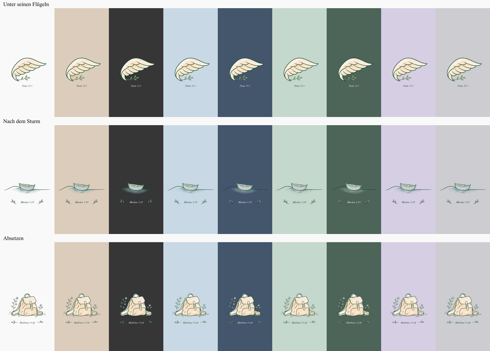
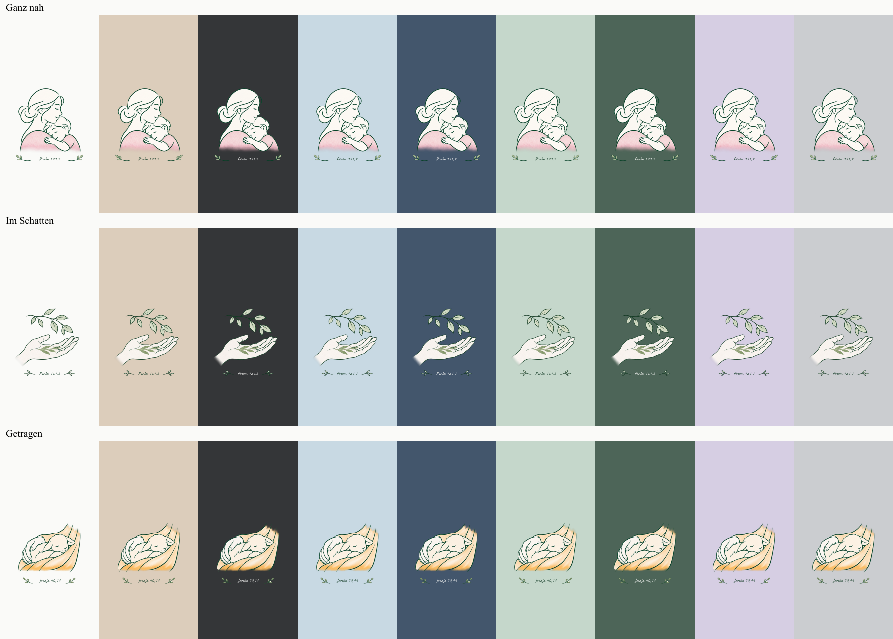

# Retusche der Hüllenmotive

Die sechs vorhandenen Illustrationen wurden mit dem eingebauten `image_gen`-Werkzeug retuschiert. Ziel sind saubere Außenkanten und weich auslaufende Aquarellflächen auf allen neun Hintergrundfarben. Motivbestandteile, Textflächen und Modellgeometrie bleiben erhalten; die Bilder wurden nicht größer gesetzt.

## Dateien und Herkunft

- Finale transparente PNG-Dateien: [`public/assets/design-foregrounds-v3`](../public/assets/design-foregrounds-v3/).
- [Manifest mit Original-, Retusche- und Ausgabeprüfsummen](../public/assets/design-foregrounds-v3/manifest.json).
- [Vollständige Prompts der ausgewählten Retuschen](design-retouch-prompts.json). Modus: eingebautes Imagegen, transparenter Hintergrund.
- [`scripts/import-retouched-artwork.mjs`](../scripts/import-retouched-artwork.mjs) setzt die ausgewählten Ausgaben proportional in die bisherige sichere Motivfläche ein. Es entfernt leere Außenränder mit vereinzeltem, praktisch unsichtbarem Generatorrauschen und bewahrt zwei Pixel Rand für die Kantenglättung. Die Motive werden um höchstens 1,92 Prozent verkleinert, niemals vergrößert oder verzerrt. RGB-/Alpha-Retusche erfolgt durch Imagegen, nicht durch diesen Import.
- Das ursprüngliche Designpaket, die Masken und die bisherige V2-Freistellung bleiben erhalten. Bestehende gespeicherte Bestell- und Druckdateien werden nicht ersetzt. Neue Konfigurationen verwenden neue Bildprüfsummen.

Die ausgewählten Motive sind: `unter-seinen-fluegeln.png`, `nach-dem-sturm.png`, `absetzen.png`, `ganz-nah.png`, `im-schatten.png` und `getragen.png`.

## Sichtprüfung

Alle 54 Motiv-/Farbkombinationen wurden als tatsächliche Shop-Komposition gerendert und visuell kontrolliert. Farbreihenfolge: Weiß, Beige, Schwarz, Hellblau, Dunkelblau, Mintgrün, Waldgrün, Flieder, Grau.

Insbesondere beim Boot wurde der körnige Wasserrand geglättet. Helle Flächen innerhalb von Boot, Flügel, Haut und Wolle bleiben erhalten. Wasser, Kleidung und Stoff laufen außen weicher in den Hintergrund aus.

## Prüfung

- Gesamte Testsuite: 91 Tests, 89 bestanden, 2 externe Integrationstests wie vorgesehen übersprungen, keine Fehler.
- Druckflächenprüfung: alle 63 vorhandenen Standardvorlagen und 37 Magnetvorlagen mit allen sechs Motiven sowie ergänzenden Textkonfigurationen. Kein bedrucktes Pixel außerhalb der geprüften Druckflächen oder in den gesperrten Kamerabereichen.
- Bildprüfung: Originale Canvasmaße, nahezu deckende helle Innenflächen, fein abgestufter Wasserübergang und keine Streupixel außerhalb der bisherigen Motivfläche.
- Browser: sechs Motive auf Schwarz in beiden Ansichten; iPhone, Samsung Ultra, Google Pixel und Z Flip; 320, 390 und 1440 Pixel Breite. Vorschau, Druckdatei und Warenkorb verwenden dieselbe Bildversion. Alle 54 Motivauswahl-/Farbkombinationen laden korrekt.
- MagSafe-Preise und Varianten bleiben unverändert. Testprüfungen erzeugen keine echte Zahlung, Bestellung bei Podbase oder E-Mail.

Die Bildschirm- und Geometrieprüfungen ersetzen keine physische Druckfreigabe. Die schematischen Hüllenansichten, Testbetriebs-Einstellungen und bisherigen Produktionssperren bleiben bestehen.
